<div align="center">


<a href="https://github.com/computedocean">
  
</a>

<br/>


[](#-recent-learning)
[](https://twitch.tv/computedocean)

</div>

<br/>

<div align="center">
  
</div>

## 👋 Hi, I'm Michael

I'm an infrastructure engineer at heart. I spent **18 years at Rackspace**, working my way up to **Windows Admin IV** and keeping enterprise Windows environments running in production: Active Directory, identity, networking, migrations, and the 2 a.m. calls nobody else wanted. Once I migrated five firewalls in a single weekend. I survived.

That career taught me how real systems behave. They break in ways nobody planned for. Good engineers inspect before they touch anything. And "done" means verified, not just deployed.

These days I'm taking that mindset into **cloud automation and AI agent engineering**. I'm less interested in AI that writes text and more interested in AI that can **understand, plan, act, verify, and learn** inside real systems, with the guardrails an ops person would insist on.

> **Build intelligent systems that can reason, plan, execute, verify, and continuously improve.**

## 🧭 Career

<div align="center">
  
</div>

### ⚡ Quick facts

```yaml
handle:   computedocean
based:    San Antonio, Texas 🤠
roots:    Windows infrastructure
loves:    automation that verifies itself
record:   5 firewalls, 1 weekend
off-hrs:  streaming on Twitch · Xbox
```

## 🔄 How I Work

<div align="center">
  
</div>

I don't believe in one-shot fixes. Reliable software and infrastructure come from **continuous inspection, implementation, verification, and review**. That's how I ran production, and it's how I build now.

## 🧰 Toolbox

<div align="center">

**Cloud & Infra**<br/>


**Automation & DevOps**<br/>


**AI & Services**<br/>


</div>

## 🚀 Current Focus

```text
CLOUD  +  INFRASTRUCTURE  +  AUTOMATION  +  AI AGENTS  =  INTELLIGENT SYSTEMS
```

My main side project is **🤖 CAOS, the Computedocean Agent Operating System**. It's where my infrastructure background meets AI: agent orchestration, persistent memory, tool execution, policy enforcement, human approvals, and audit logging. The goal isn't another chatbot. **It's an operating system for intelligent agents.**

### 🎓 Recent Learning

<table>
  <tr>
    <td width="200" align="center">
      <a href="https://github.com/computedocean/virtual-universe-26">
        
      </a>
    </td>
    <td>
      <b>GitHub Virtual Universe '26</b> · completed October 2026<br/><br/>
      Hands-on with GitHub's newest agent-era features: <b>stacked pull requests</b>, <b>Copilot agents and automations</b>, and <b>AI-powered security</b> like AI Scan and package firewall.
    </td>
  </tr>
</table>

## 📊 Activity

<div align="center">


<picture>
  <source media="(prefers-color-scheme: dark)" srcset="https://raw.githubusercontent.com/computedocean/Computedocean/output/snake-dark.svg" />
  <source media="(prefers-color-scheme: light)" srcset="https://raw.githubusercontent.com/computedocean/Computedocean/output/snake-light.svg" />
  
</picture>

</div>

## 🎮 Off the Clock

When I'm not building, I'm usually gaming on Xbox or streaming on Twitch. Come say hi.

[](https://twitch.tv/computedocean)

<div align="center">

### ⚡ Infrastructure roots. AI-agent future.


</div>
